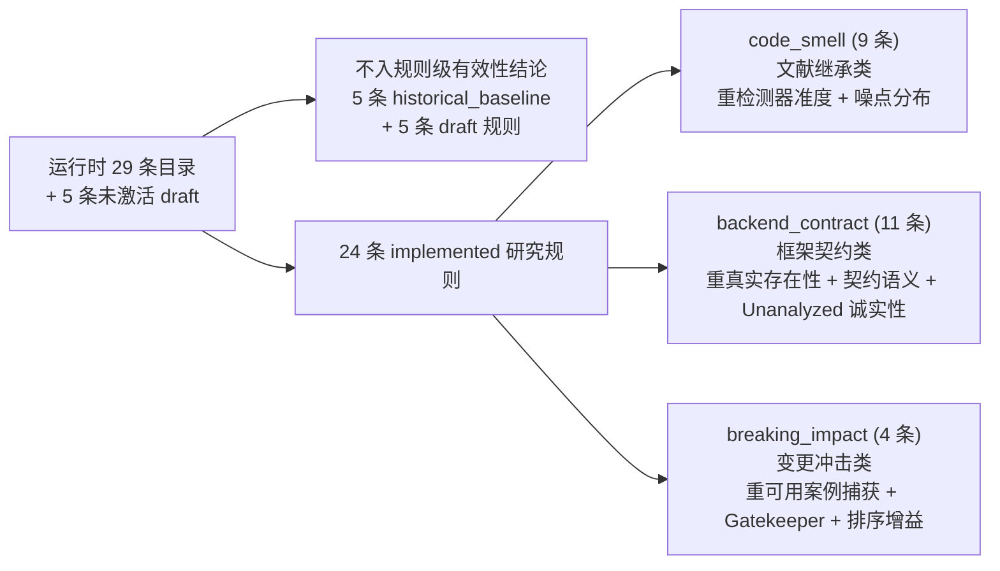

# Prisk v1.4 有效性证明方法论与定性决策矩阵 (`validation-strategy.md`)

> [!IMPORTANT]
> **口径基准声明**：本文档严格对齐 Prisk 当前最新 **v1.3.0 动态变更审查架构**（见 [`docs/architecture.md`](../../architecture.md)、[`v1.3.0` 里程碑归档](../../versions/v1.3.0/README.md) 与 [`branch_analysis.py`](../../../backend/prisk/services/branch_analysis.py)）、[`docs/rules/rule-responsibility-matrix.md`](../../rules/rule-responsibility-matrix.md) 及长期架构决策 [`ADR-0001`](../../adr/0001-v14-validation-strategy.md) 编写。
> - **与 `v1.0.0` 路线解耦**：不再将 `v1.0.0` 离线批处理串联脚本（`stage03`–`stage07`）当作核心研究方法论或产品主线；所有评估围绕面向任意 Git `base...head` 变更快照的一体化审查管线展开。
> - **纯定性方案与已定案裁决**：本文档专注拆解“有效性究竟指什么”“各规则阵营各自背负何种证明义务”“如何在缺少第三方权威专家评审的情况下规避单一作者对真实 PR 逐条主观打标的偏误（Author Bias）”，**不预设定量样本条数、校准权重数值或精确率通过阈值**；[第 6 节](#6-所有者决策槽位已定案并固化至-adr-0001) 的四项定性选型已由所有者与工程评审正式拍板，并沉淀为 [`ADR-0001`](../../adr/0001-v14-validation-strategy.md)。

---

## 1. 被测系统最新口径与“有效性”的准确边界

### 1.1 当前系统的工程与产品形态（v1.3.0 基准）

Prisk 当前已经从 `v1.0.0` 时期面向单一演示仓库的离线批处理脚本演进为面向任意 Git 仓库的**动态变更风险审查与决策支持引擎**：

1. **统一审查入口（`analyze_branches`）**：以任意 Git 仓库的 `base...head` 三点 Diff 已提交快照（或由双提交历史重构的 PR 隔离快照）为输入，自动识别非测试 Python 业务文件（不再依赖特定仓库前缀硬编码），输出结构化审查报告（`stage08.branch-report.v1`）。
2. **局部 AST 证据与三态规则引擎**：在 Diff 变更范围与 `base`/`head` 源码 AST 之间提取结构化证据，每条规则显式产出 **`Hit`（命中）/ `NotFound`（未触发）/ `Unanalyzed`（未分析并附原因码）** 三种状态及证据代码切片，拒绝将解析缺失或上下文不足静默记为“安全通过”。
3. **规则体系与 Gatekeeper 一票抬升**：运行时内置 24 条精细规则与 5 条历史兼容演示规则；其中高危规则（`auth.drf_permission_policy_downgrade`、`data.django_destructive_migration`）配置了 `gatekeeper: true` 标记，可在低综合分值场景下触发 `gatekeeper_lift` 一票抬升复核等级。
4. **场景预设、参数可配与配置可复现**：通过 [`config.py`](../../../backend/prisk/domain/config.py) 解耦 5 套命名预设（`balanced`、`security_focus`、`framework_upgrade`、`daily_review`、`legacy_baseline`）及规则开关、权重与内部参数阈值（如 `code.deep_control_flow` 的 `max_depth` 与 `code.hardcoded_secret` 的 `min_length`），每份审查结果强制固化包含 `SHA-256` 十六进制摘要截断前 16 位 `config_digest` 的 `config.snapshot.v1` 快照。
5. **三级快照缓存局部重跑（`AnalysisSnapshotCache`）**：支持全量分析、仅重算规则与仅重算评分的三级缓存重演，使得在同一份样本快照上进行多配置预设对照与消融实验无需重复执行 Git Diff 与 AST 提取。

> [!NOTE]
> **工程接口衔接提示（留待后续落地任务适配）**
> 前序 Task 031 交付的 `eval_cli` 聚合与对比入口当前仍读取批处理结果文件形态。待本方案完成决策选型后，可在后续执行任务中直接让聚合引擎适配读取 `analyze_branches` 产出的 `stage08.branch-report.v1` 载荷（完整包含 `rule_outcomes`、`findings`、`score_basis`、`gatekeeper_lift` 与 `config_snapshot`），无需退回 `v1.0.0` 分步脚本模式。

### 1.2 “有效性（Effectiveness）”在论文语境中的四层准确含义

Prisk 定位为**基于确定性静态证据的变更风险初筛与复核优先级分诊系统**，并非生产缺陷预测器或在线漏洞利用验证器。因此，`v1.4.0` 阶段所称“证明系统有效”不采用“Hit = 必然爆发线上 Bug”或“分数 = 缺陷概率”的过度承诺，而是拆解为以下四个递进且可客观检验的闭环命题：

| 有效性层次 | 核心要证明的命题 | 反面失效情形（若失败说明什么） |
| :--- | :--- | :--- |
| **L1：检测器实现准确性** （Detector Accuracy） | 规则引擎在代码语法与 Diff 增量语义上是否严格按照规则卡片定义工作：正例稳定命中、反例与边界陷阱稳定不误报。 | 检测器实现有逻辑漏洞、把正常惯用法当异常模式、或运行时实现偏离文档契约。 |
| **L2：噪点收敛与覆盖诚实性** （Noise & `Unanalyzed` Honesty） | 在真实复杂项目连续 PR 流中，规则是否保持适度触发而不发生告警饱和；面对框架缺失或动态语法时，是否诚实输出 `Unanalyzed` 而非静默漏报或强行误报。 | 高频通用规则淹没整份审查报告（告警疲劳），或面对外部仓库因缺少上下文而虚报零风险。 |
| **L3：系统级风险排序与抬升效度（待检验命题）** （Ranking & Gatekeeper Effectiveness） | **将要检验的核心命题**：在真实开源 PR 演化中，被 Prisk 归为高危 / Gatekeeper 抬升 / 高风险分的变更，是否比仅依据“改了多少行”的规模基线及历史演示规则，更常对应人类维护者评审阻力、高于随机基线的行内聚焦讨论及社区风险返工动作。 | 综合评分只是“变更行数越多分越高”的等价替代，或者高危分组与历史维护者客观代理信号之间不存在有效区分度。 |
| **L4：跨项目双层边界与配置可复现性** （External Generalization, Backoff & Reproducibility） | 分离两层跨仓命题进行检验：1) 面对大型非 DRF / 非 NetBox 基类项目（**G3a：`saleor/saleor`**），通用 Python 规则能否迁移运行、DRF 规则是否按契约安全退避（`Unanalyzed`）而不大面积误报；2) 面对真正使用 DRF 的独立开源项目（**G3b，待 Task `033` 筛选**），DRF 契约规则能否跨仓有效迁移；且不同配置对比均可经 `config.snapshot.v1` 精确追溯。 | 混为一谈“非 DRF 退避”与“DRF 迁移”，或规则体系死锁单一仓库目录惯例、调参对比无法固定变量。 |

---

## 2. 强对齐《规则责任矩阵》：三大阵营的差异化验证义务

按 [`rule-responsibility-matrix.md`](../../rules/rule-responsibility-matrix.md) 与 [`rule-registry.json`](../../../backend/data/rules/rule-registry.json)，当前参与研究的 **24 条 `implemented` 规则**（及体系外的 **5 条历史演示规则**与 **5 条未激活 `draft` 规则**）承担截然不同的学术与工程证明责任，**严禁使用单一的“全员同口径人工读 Diff 算 Precision”方式一刀切评估**。

### 2.1 `code_smell`（文献继承类，9 条 `implemented`）

- **成员清单**：`code.swallowed_exception`、`code.bare_exception`、`code.dynamic_execution`、`code.hardcoded_secret`、`code.unmanaged_open`、`code.deep_control_flow`、`code.global_mutable_state`、`code.mutable_default_argument`、`code.assert_in_production`。（另有 `code.dead_code_after_exit` 处于 `draft`，不运行。）
- **论文责任**：说明问题本身为何值得关注，通过引用 MITRE CWE、OWASP Top 10、PEP 规范、Python 官方文档或既有软件工程实证研究提供**危害先验合理性**。因此，**无需在实证阶段重新证明“吞异常或裸 `eval` 是坏习惯”**。
- **工程验证重点**：
  1. **AST/Diff 检测器忠实性**：构造正例、反例、注释/字符串遮蔽、未改动历史残留代码等边界用例，证明 Prisk 的实现严格符合卡片定义（并诚实暴露类似 [`rule-registry.json`](../../../backend/data/rules/rule-registry.json) 已记载的 `code.bare_exception` 合同与实现差异以指导修正或界定边界）。
  2. **高敏参数阈值治理与噪点收口**：该阵营最容易因正则或结构宽泛引发大量低价值误报（特别是含可配参数 `RULE_PARAM_SCHEMAS` 的 `code.deep_control_flow`、`code.hardcoded_secret`，以及 `code.global_mutable_state`、`code.assert_in_production`）。需要在真实大型仓库中通过自动化触发统计与局部切片诊断，证明阈值收敛后误报噪点可控。

### 2.2 `backend_contract`（框架契约类，11 条 `implemented`）

- **成员清单**：
  - 接口路由与暴露（4 条）：`api.drf_public_parameter_added`、`api.drf_public_parameter_removed`、`api.django_url_pattern_changed`、`api.drf_viewset_action_changed`
  - 权限与访问控制（4 条）：`auth.drf_permission_decorator_removed`、`auth.drf_permission_policy_downgrade`（**`gatekeeper: true`**）、`auth.django_csrf_exempt_added`、`auth.drf_queryset_scope_tighten_bypassed`
  - 数据与框架配置（3 条）：`data.django_raw_sql_execution`、`config.django_sensitive_settings_changed`、`data.django_signal_receiver_leak`
  （另有 `auth.drf_object_permission_bypass`、`auth.django_permission_module_changed` 处于 `draft`，不运行。）
- **论文责任**：阐述 Django/DRF 框架内置契约机制、规则静态识别逻辑与项目结构语境；文献引用不免除框架规则在真实项目中的契约语义验证。
- **工程验证重点**：
  1. **真实存在性与三态覆盖率**：在真实的 Django/DRF 项目演化流中，验证规则不是仅存在于构造玩具代码中的“幽灵规则”，且能观测真实触发频次与稀缺分布。
  2. **契约语义准确性与双层外部对照边界**：通过公开可审的受控契约正反例与真实维护者行内关注区对照（如原生 SQL 拼接 vs 参数化绑定、权限策略降级 vs 等效继承），检验语义误伤控制；同时严格分拆双层外部对照——在 **G3a（`saleor/saleor`，Django + GraphQL-only 非 DRF 项目）** 专门检验非 DRF 环境下 DRF 规则是否诚实落入 `Unanalyzed` 而不乱触发；在 **G3b（待 Task `033` 筛选的真实 DRF 项目）** 专门检验 11 条 `backend_contract` 规则的跨仓契约迁移性（不在 Saleor 上声称已验证 DRF 迁移）。

### 2.3 `breaking_impact`（变更冲击类，4 条 `implemented`）

- **成员清单**：`workflow.test_collaboration_gap`、`data.django_destructive_migration`（**`gatekeeper: true`**）、`data.django_non_null_constraint_tightened`、`data.django_field_rename_without_db_column`。（另有 `data.django_transaction_boundary_changed`、`workflow.large_change_scope` 为延后 `draft` 卡片，不运行。）
- **论文责任**：清晰界定变更导致兼容性或回归冲击的工程机制、特征组合边界，并严格约束结论边界——过程协同信号（如修改业务代码但未同步改测试）**只表示“审查优先度需提高”，不直接断言必然破坏线上系统**。
- **工程验证重点**：
  1. **可用高危案例捕获与 Gatekeeper 抬升行为**：重点依托社区中带有迁移回滚、字段删改、破坏性标签或审查阻断记录的真实 PR，验证 `data.django_destructive_migration` 等高危机制在真实发生时能否稳定命中并触发 `gatekeeper_lift`。
  2. **权重/阈值敏感性与系统排序增量价值**：验证 `workflow.test_collaboration_gap` 这类高频信号与重度数据变更规则结合时，如何在不同预设权重配置下避免把所有普通特性 PR 都推高，而真正提升需要优先审查的高风险 PR 排序表现。

### 2.4 明确剔除范围（体系隔离声明）

- **5 条历史基础演示规则（`historical_baseline`）**：`api.signature_changed`、`auth.permission_structure_changed`、`data.transaction_structure_changed`、`config.configuration_structure_changed`、`code.exception_structure_changed`。
  - **处置边界**：依据 [`rule-responsibility-matrix.md`](../../rules/rule-responsibility-matrix.md) 约定，该 5 条规则仅保留于预设 `legacy_baseline` 中用于系统级回归兼容性与历史基线消融对比，**不纳入 `v1.4.0` 规则阵营分类统计，不为其计算单规则有效性与准确率结论，亦不作为新默认推荐权重的设计主体**。
- **5 条 `draft` 状态规则**：`code.dead_code_after_exit`、`auth.drf_object_permission_bypass`、`auth.django_permission_module_changed`、`data.django_transaction_boundary_changed`、`workflow.large_change_scope`。
  - **处置边界**：运行时未启用，严禁出现在 `v1.4.0` 实验通过率或命中统计分母中。

---

## 3. 破解“无权威专家、自评缺说服力”：六条验证路径全景解析

当研究工作处于单人完成开发与评估、又无法邀请多名资深工业界核心开发者开展双盲全量代码审计时，如果依赖“作者本人逐个看 PR 后自行打分说某条规则很准”，在论文答辩环节极易受到**Author Bias（自己测自己、确认偏误）**与**评审公信力不足**的质疑。

下文客观梳理 `v1.4.0` 可选的六条具体验证机制，重点剖明每一条路径**不需要作者主观裁决就能证明什么**，以及各自的**盲区与局限**：

### 路径 P1：公开可审查的受控结构微基准（Micro-Benchmark Suite）

- **核心原理**：不面向整篇巨型业务 PR，而是针对全部 24 条 `implemented` 规则各自的触发条件与常见误报陷阱，设计最小可控代码差异片段（正例、合法反例、注释/字符串遮蔽、AST 解析异常降级用例），作为可独立执行的确定性基准集接入 `analyze_branches` 自动化运行。
- **为什么不必与“作者给真实 PR 自标精确率”混为一谈**：P1 夹具虽由开发者按规则卡片构造，但其源码输入、卡片契约条件与预期三态结果完全**公开透明、可供任何读者与评审者独立检查并一键重跑**，检验的是**“检测器代码实现是否忠实于规则规格定义”**；这与“研究者通读复杂业务 PR 并自行裁决真实精准率分母”完全不是同一件事。
- **局限与盲区**：不能代表真实复杂开源项目的自然出现频次与背景噪点密度，须结合 P2–P5 在真实样本上检验。

### 路径 P2：大样本自动化三态覆盖与命中上下文聚类诊断

- **核心原理**：直接利用系统一体化 `analyze_branches` 管道对大规模非测试 Python PR 窗口自动批跑，不依赖人工阅读全文，而是直接基于机器结构化输出统计每条规则的 **三态占比分布（`Hit` / `NotFound` / `Unanalyzed` 及其原因码）**，并对触发高频规则的 Finding 按 AST 节点形态、文件路径特征与参数档位做自动化上下文聚类。
- **无需权威背书就能证明什么**：
  1. 客观暴露哪些规则属于“几乎每次 PR 都触发的高噪饱和信号”、哪些规则长期稀缺、哪些跨项目场景可靠落入 `Unanalyzed`；
  2. 结合 [`config.py`](../../../backend/prisk/domain/config.py) 的 `rule_thresholds`（如 `max_depth`、`min_length`）与 `AnalysisSnapshotCache` 局部重跑能力，客观展示阈值收紧前后的收敛效果，而无需主观裁决“我觉得这个变量名是不是密码”。
- **局限与盲区**：三态分布和聚类只能反映触发频率与分布结构，不能直接判断单次 `Hit` 在特定业务语境中是否属于真正的风险。

### 路径 P3：GitHub 第三方历史评审阻力信号（External Maintainer Friction Proxy）

- **核心原理**：已合并的历史开源 PR 在 GitHub 上天然留存了项目**原核心维护者与真实协作者**当年产生的客观审查元数据——是否曾收到 `CHANGES_REQUESTED` 状态、正式 Review 往返轮次、审稿人总批注数、是否发生多轮修改补救等。用**当年真实维护者的工程注意力投入**作为独立外部代理变量，对照 Prisk 对同一历史快照（**严格仅给 Prisk 看合入基线与初始提交或完整变更快照，绝不向规则引擎泄露未来评审记录**）给出的风险等级与分值进行排序对比。
- **可提供哪些外部代理依据**：**检验**核心研究命题——“对于原仓库维护者当年觉得需要打回重改的变更，Prisk 分诊系统是否倾向于给出更高的优先复核排序，并相较单纯‘修改行数（LOC）’基线与旧版 `legacy_baseline` 具备增量区分度”。主体事件来源于原仓维护团队当年工程行为，规避作者本人对真实 PR 自标“对/错”的偏误。
- **局限与代理噪声边界**：必须承认 `CHANGES_REQUESTED` 与多轮评论**仍属带噪声的外部代理真值（noisy proxy）**——可能源于产品设计争议、代码风格分歧而非静态安全/契约隐患，且人类审稿同样存在疏漏。

### 路径 P4：GitHub 行内评审批注位置对齐（Inline Review Comment Proximity Alignment + Chance Baseline）

- **核心原理**：不仅观察整条 PR 是否被打回，而是把原仓维护者留在具体文件与具体行号上的 **GitHub Inline Review Comments**（按文件与 Diff hunk / 附近行窗口对齐）与 Prisk 产出的 Finding 证据位置（`file path` + `node / diff lines`）作空间交集匹配；**同时必须构造基于同 PR 变更文件行数 / Hunk 体积的随机行重叠机会基线（random line-overlap chance baseline）作归一化对比**。
- **可提供哪些外部代理依据**：检验 Prisk 标记的高风险片段在空间上与人类行内批注重合的程度是否**超出同体积变更下的随机机会基线**、落在审稿人实际停下来质询的局部代码邻域，补充 PR 级信号的局部空间依据。
- **局限与代理噪声边界**：引入随机行重叠机会基线可避免“改动越大、批注越多导致偶然重合”的假象；但部分项目维护者习惯集中写总评而非行内评论，且行内问题与静态规则边界并不完全一对一重合。

### 路径 P5：社区公开风险标签与合入后返工追踪（Community-Endorsed Risk & Rework Proxies）

- **核心原理**：从目标项目及其同栈社区（或独立靶向样本窗口）采集**客观上已带有社区共识风险印记的 PR** 与常规对照样本——具体包括：仓库维护者标注的 `security` / `bug` / `regression` / `breaking change` / `migration` 等历史 Issue/PR 标签关联变更、修复此前合并变更的后续 `Revert` / `Fixes #...` 关联引入提交（通过追溯被回滚或紧接着被紧急修复的原合并 PR 快照进行回测）。
- **无需权威背书就能证明什么**：为 `backend_contract`（如权限降级、CSRF 豁免、原生 SQL）与 `breaking_impact`（如破坏性迁移、字段改名）这类天然稀缺高危规则提供**无需作者背书的真实已知高危靶标**，客观检验系统及 `gatekeeper_lift` 机制在面对真实已知问题时的召回率与分组抬升能力。
- **局限与盲区**：社区标签与后续 `Fixes`/`Revert` 并非穷尽标注，未被打标 PR 并不绝对等同于“绝对无风险”（即只能确立较高的真实正例参照，而不能当作全量负例真值表）。

### 路径 P6：全样本人工核验 vs 极窄作用域人机协同规范检查（Bounded Specification Audit）

- **核心原理**：审慎界定研究者的个人人工介入边界。
  - **传统全样本人工读 Diff（重标注路线）**：由研究者本人通读每条完整 PR Diff 并按四值词表判定规则对错。当样本规模较大且缺乏跨人交叉验证（Inter-Rater Reliability, Cohen's κ）时，审稿人消耗极高，且极易被质疑“规则作者亲自下场给自己的告警判正确”。
  - **窄域规范一致性复查（辅助核对路线）**：仅将个人核查收敛到极小作用域——例如只针对路径 P2 暴露出的高噪聚类异常、或少数难以通过 GitHub 元数据体现的逻辑规则提取**固定脱敏的局部代码切片**，依据公开机械化的客观规则定义（如 AST 是否确为 `except: pass`、函数体嵌套层数是否达到阈值）核对“代码结构事实是否成立”，而非由作者主观拍脑袋“我认为这行代码将来会出线上事故”。同时仅选取少量典型案例用于论文定性剖析与 UI/报告可解释性展示。
- **无需权威背书就能证明什么**：极窄作用域切片复核可辅助定位工具级误报原因与调参依据；但它**只适合作工程辅助诊断与论文案例展示，不应单独承担论文有效性的核心统计支柱**。

---

## 4. 核心定性决策矩阵（与 `ADR-0001` 一致）

### 4.1 矩阵 A：总体实证路线组合对比矩阵

下表将可选组合收敛为四条结构化总体路线，按六个核心学术与工程维度展开定性对比（注：所有依托历史元数据的外部方案均坦承代理信号存在噪声，重点在于规避作者本人对真实 PR 逐条主观打“对/错”造成的 Author Bias）：

| 评估维度 | 方案 I：纯全量单人人工核验路线 （旧思路延续） | 方案 II：纯 GitHub 外部代理信号黑盒对比 （完全弃用规则级检视） | **方案 III（已选定）：三层客观混合与外部代理体系** `P1 公开微基准 + P2 自动三态诊断 + P3/P4(含随机基线) + P5 社区公开案例` | 方案 IV：方案 III + **窄域切片规则规范复核** |
| :--- | :--- | :--- | :--- | :--- |
| **证明链核心逻辑** | 全靠单人通读 PR Diff 标注每条命中对错并算人工 Precision。 | 不看单规则对错，只算总分与 GitHub `changes_requested` 等外部元数据的相关性。 | **分而治之、不依赖真实 PR 单人主观标分**：P1 公开可查微基准核验规则实现忠实度；P2 自动统计大样本噪点与三态边界；P3/P4(带随机行重叠基线)/P5 以第三方历史事件作为外部代理参照。 | 以方案 III 为主干，额外对少量 P2 高噪聚合切片作机械规范核对清单。 |
| **规避 Author Bias 能力** | **弱**：单一作者既是工具制作者又是裁判员，无第三方盲审支撑，答辩最易被质疑。 | **强（系统层）/ 极弱（规则层）**：系统端客观，但无法回答单个 AST 规则本身实现是否准确。 | **较强（非“零主观/零噪声”）**：规则实现准度靠任何人均可检查重跑的 P1 证实，触发分布靠 P2 程序复算；系统有效性与定位对齐借助第三方历史事实检验（并显式报告代理噪声局限）。 | **较强（前提是严控 P6 边界）**：但仍存在评审人追问极少量切片人工一致性检验的风险。 |
| **对个人资深代码审计功底依赖** | **极高**：面对大型开源仓跨模块业务 Diff 容易误判正常契约与复杂并发意图。 | **低**：统计与归因主要基于程序与仓库公开元数据。 | **低**：P1 基于明确语言/框架语法卡片；P2–P5 完全由静态统计与仓库历史事件驱动。 | **中低**：需谨慎阅读少量异常局部切片。 |
| **与《规则责任矩阵》贴合度** | **差**：对 24 条三类阵营一刀切，违背各自不同的论证义务。 | **差**：把整个系统视为黑盒，无法回应各阵营规则实现与契约边界问题。 | **高**：文献类走 P1+P2；框架契约类走 P1+P2(G3a+G3b)+P4+P5；变更冲击类走 P1+P2+P5+P3；系统层面检验 P3/P4/P5 排序增量。 | **高**。 |
| **工程实施与数据获取可行性** | **极差（工时高压）**：人工通读大规模 PR 难扩样本。 | **优**。 | **良好（适度增量开发）**：后续 Task `033` 完善 P1 公开夹具、将 `eval_cli` 对齐 `stage08.branch-report.v1`、并抓取 P3/P4/P5 元数据及随机行重叠基线。 | **良好**：工时略增用于整理少量切片核对说明。 |
| **答辩规范性与残余局限** | 难以反驳“自标自准”偏见质疑。 | 难以证明分数不是“改得越多越高”且单个规则是否写对。 | 需在论文中坦承 P3/P4/P5 属于**存在噪声且非穷尽的代理真值**、P1 夹具属规格验证而非真实流行度样本；结构严谨、局限边界诚实可控。 | 仍需解释局部手工切片与整体样本代表性关系。 |

### 4.2 矩阵 B：规则阵营 × 检验目标 × 外部代理参照矩阵

围绕“不同规则不需要采用同一种证明方法”的核心原则，确立以下分阵营验证对照表：

| 评估对象 | 在系统中承担什么角色 | 将要检验的核心命题（待验证假设） | 选定验证路径 | 外部参照与控制基线 | 明确**不声称**的过界结论 |
| :--- | :--- | :--- | :---: | :--- | :--- |
| **`code_smell`** （9 条，文献继承类） | 捕获可局部观测的编码异味与基础安全坏味道 | 1. AST/Diff 检测器是否严格符合公开可审查的正反微基准边界； 2. 参数阈值治理（如 `max_depth`、`min_length`）能否压低真实大样本里的过宽饱和告警； 3. 通用 Python 规则能否迁移至非 NetBox 项目。 | **P1（核心） + P2（含 G3a `saleor`） + P4（辅助）** | - 危害依据：CWE / OWASP / PEP / Python 官方文档； - 准度与边界：P1 公开正反测试集 + P2 AST 上下文聚类触发变化。 | 不单独声称“每一条编码异味必然导致线上安全事故或单独引发 PR 被拒”。 |
| **`backend_contract`** （11 条，框架契约类） | 暴露接口兼容性变更、权限策略回退与框架安全契约违背 | 1. 在 NetBox 真实演化中是否真实发生； 2. **G3a（`saleor/saleor` 非 DRF 仓）**：DRF 专属规则遇到 GraphQL-only 非 DRF 代码时是否诚实退避为 `Unanalyzed` 而不误报（不用于声称 DRF 迁移）； 3. **G3b（待选真实 DRF 仓）**：在异仓 DRF 项目中契约规则是否可迁移触发； 4. 关键发现与行内批注焦点及社区风险案例的对齐倾向。 | **P1 + P2（G3a / G3b 分列） + P4（含随机基线） + P5** | - 框架契约语义：Django/DRF 官方契约与 P1 契约正反例； - 真实世界代理：维护者行内评论聚焦区（相对于随机行重叠基线）、社区安全/回归标签 PR 与 Fix 记录。 | 不声称静态识别能够解决所有运行时动态权限配置与中间件组合绕过；不在非 DRF 仓上外推 DRF 迁移性结论。 |
| **`breaking_impact`** （4 条，变更冲击类） | 捕捉迁移破坏、字段约束收紧与变更测试协同缺失，提供一票抬升兜底 | 1. 破坏性迁移 `data.django_destructive_migration` 等在社区高危样本中能否稳定捕获并通过独立开启 `gatekeeper_lift` 获得抬升； 2. 协同缺失与破坏冲击信号对整体排序区分的贡献边界。 | **P1 + P2 + P5 + P3（系统层结合）** | - 迁移/兼容性真实代理：带迁移故障、`Revert`、`breaking` 印记的真实 PR 及其对照； - 排序对照：G2a/G2b 单因子消融与评审阻力分组比较。 | 不直接将“缺少测试改动”等同于“代码有 Bug”，仅作为提升复核优先级的协同证据。 |
| **系统整体排序与 Gatekeeper** （24 条组合输出，已剔除 5 条历史演示规则） | 综合评分、高/中/低分诊及高危一票抬升决策支持 | **核心待检验命题**：检验综合分诊分级与 `gatekeeper_lift` 是否相较纯规模基线（G0）及历史基线（G1），更常把审查注意力优先引导向客观阻力更高、行内批注密度高于随机重合基线及更易出现社区风险返工的变更。 | **P3 + P4（含随机基线） + P5 + 单因子消融** | - 客观外部代理参照：真实开发者的 `changes_requested`、Review 轮次、归一化行内批注重合度及后续回滚/返工标签分布。 | 不替代 CI/测试或资深研发人员最终拍板合并决定；分数本身不代表 Bug 发生概率百分比。 |

### 4.3 矩阵 C：单因子消融对照与双层外部仓矩阵（G0–G3b）

借助 `analyze_branches` 的 `config.snapshot.v1` 固化机制与 `AnalysisSnapshotCache` 三级局部重跑特性，在完全同一份隔离冻结的真实样本快照上**拆解单个变量**执行公平对照，严禁把多处改动混在一次比较里：

| 对照维度 / 实验组 | 单一变动因子设计 | 严格控制不变量 | 要独立回答的科学问题 |
| :--- | :--- | :--- | :--- |
| **基线对照组 G0：变更规模基线** （Size-Only Baseline） | 仅基于 PR 变更行数（LOC）或变更非测试 Python 文件数进行排序。 | 完全相同的真实 PR 快照与外部代理真值（P3/P4/P5）。 | **消除规模混淆变量**：检验 Prisk 风险排序是否能超越“改得越多的 PR 越容易被批注”的纯体积规律。 |
| **历史对照组 G1：`legacy_baseline` 预设** （`v1.0`–`v1.2` 兼容基线） | 仅计分历史 5 条演示规则（+1 分协同），24 条精细规则权重全部置 0。 | 相同的项目样本、AST 与 Diff 提取快照（仅切预设）。 | **独立验证剔除历史演示规则 + 升级 24 条精细规则的演进增益**。 |
| **单因子消融 G2a：参数阈值治噪与场景权重校准** （等权/未收敛阈值 vs 收紧 `rule_thresholds` 与校准权重） | 在**同样仅用 24 规则且保持同一 Gatekeeper 状态**下，比较未收紧初始参数/等权设定与经 P2 饱和度诊断收敛 `rule_thresholds` 并调整权重后的变化。 | 相同的 24 规则体系、相同的 Gatekeeper 开关与同批 PR 快照（各自固化 `config_digest`）。 | **独立剥离参数降噪与权重调整的增量贡献**（不再与 G1 历史规则剥离或 Gatekeeper 混捆）。 |
| **单因子消融 G2b：Gatekeeper 开关独立消融** （开启 vs 关闭 `gatekeeper_lift`） | 在**完全相同的 24 规则权重与内部阈值配置**下，**仅单独切换 `gatekeeper_lift` 开启与关闭**。 | 相同的 24 规则启用集、相同权重、相同阈值与同批 PR 快照。 | **独立检验 Gatekeeper 机制净贡献**：观测 `data.django_destructive_migration` 与 `auth.drf_permission_policy_downgrade` 一票抬升对小体积高危 PR 召回与排序的独立增量效果。 |
| **外部退避对照 G3a：`saleor/saleor`** （大型 Django + GraphQL-only 非 DRF 仓） | 从官方明确为 `"GraphQL only"`、主 API 非 DRF 的 **`saleor/saleor`** 抽取样本，直接经 `analyze_branches` 通用非测试 `.py` 业务分类跑测。 | 使用相同的系统核心代码与预设，零仓特定目录白名单或适配器。 | **检验 L4-a 跨仓迁移与非 DRF 诚实退避边界**：检验通用 Python `code_smell` / Django 规则跨仓适用性，并验证 DRF 专属规则在非 DRF 环境下诚实退避为 `Unanalyzed` 而不误报（不把这误算作 DRF 契约可迁移）。 |
| **外部迁移对照 G3b：真实 Django + DRF 项目** （具体仓库由 Task `033` 筛选确立） | 在 Task `033` 另行筛选真正以 **DRF**（`ViewSet`/`APIView`/Serializer/`permission_classes`）构建 API 的非 NetBox 开源项目，以通用非测试 `.py` 业务分类跑测。 | 使用相同的系统代码、通用业务路径分类与对应预设。 | **检验 L4-b DRF 框架契约跨仓迁移性**：独立于 G3a 正面检验 11 条 `backend_contract` 规则在真实异仓 DRF 代码上的适用性（以及对未登记自定义 DRF 基类的 `Unanalyzed` 退避行为）。 |

### 4.4 矩阵 D：潜在有效性威胁（Threats to Validity）预置响应策略

论文撰写时主动采用严谨克制的学术限定策略，提前封堵审稿与答辩阶段常见质疑：

| 威胁类型 | 可能受到的具体质疑 | 论文与方法论预置应对策略 |
| :--- | :--- | :--- |
| **构造效度威胁** （Construct Validity） | 1. “GitHub 的 `CHANGES_REQUESTED` 或审稿轮次不等于程序缺陷。” 2. “行内批注重合可能源自改动行数多造成的偶然重叠；社区缺失标签不代表绝对无缺陷。” | **明确研究定位并控制机会基线**：问题定义界定为“确定性静态变更风险初筛与复核优先级分诊”而非“在线缺陷必发预测”；坦承 P3/P4/P5 均属**有噪声、非穷尽的代理真值（proxy）**；`P4` 必须对照同体积改动下的**随机行重叠机会基线**作归一化；社区未打标样本仅作对照参照，绝不宣称为零缺陷负例。 |
| **内部效度威胁** （Internal Validity） | 1. “没有双盲资深工程师对真实 PR 全量人工标注准确率。” 2. “P1 夹具同样由开发者编写，如何保证没有自己写题自己答、且多因素调优没有混杂归因？” | **明确区分规格夹具与真实自标，并实行单因子消融**：不以单一作者对真实 PR 主观标注的精确率充当核心结论支柱，规避确认偏误；P1 夹具定位为**公开可审查、可一键重跑的卡片规格回归检验**，任何评审者均可直接审阅夹具正反代码与预期边界；实验对照严格拆为 `G1`、`G2a`、`G2b` 三个单因子对比组确保归因清晰。 |
| **外部效度威胁** （External Validity） | “主实验集中在 NetBox；而 `saleor/saleor` 并非 DRF 仓库，能否说明 DRF 规则推广到其他项目？” | **严谨区分“非 DRF 退避”与“DRF 同栈迁移”双对照（G3a + G3b）**：将 `saleor/saleor`（G3a）严格定位为大型 Django + GraphQL-only 非 DRF 仓，只证明通用规则跨仓性与 DRF 规则不胡乱触发；DRF 契约规则的跨仓迁移能力专门交由另行筛选的真实 DRF 项目 **G3b** 独立验证，研究栈仍严格限定于 Python / Django / DRF 生态。 |
| **可靠性威胁** （Reliability） | “多轮配置调优后实验结论还能不能一一复现？” | **工程机制硬约束保证**：依赖 `exclusion-list.json`（136 条历史 PR）与 `eval_cli check-isolation` 保证正式集与历史 `v1.0.0`/`v1.1.0` 样本零交叠；依赖 `analyze_branches` 双提交隔离快照与 `config.snapshot.v1` + **SHA-256 十六进制摘要截断前 16 位 `config_digest`** 锁定配置参数，消除环境与参数漂移。 |

---

## 5. 与毕业论文实证章节（RQ1–RQ4）映射及后续落地边界

结合已定案的 `ADR-0001`，后续实证阶段直接对接毕业论文四个研究问题与工程实现边界：

| 论文研究问题（RQ） | 本质待检验问题 | 直接对应的实证产物与对照 |
| :--- | :--- | :--- |
| **RQ1：检测规格忠实性与三态覆盖特性** | Prisk 24 条精细规则在实现语义上是否忠实于公开边界定义？真实样本下三态分布与参数治噪效果如何？ | P1 公开微基准正反边界通过率 + P2 大样本三态分布及 `G2a` 阈值收紧前后降噪对比。 |
| **RQ2：稀缺高危捕获与 Gatekeeper 独立净增益** | 面向权限降级、破坏性迁移等低频高危变更，系统及单独开启 `gatekeeper_lift` 能否有效避免被小体积改动淹没？ | P5 社区已知高危与回归返工案例捕获 + `G2b`（相同权重/阈值下单独开关 Gatekeeper）消融对比。 |
| **RQ3：系统级风险排序检验与历史基线消融** | 相比纯改行数基线（G0）及历史 5 条演示规则（G1），采用 24 条精细规则与场景校准配置是否更符合维护者注意力代理信号？ | P3/P4（含随机行重叠机会基线）检验下的 G0 / G1 / G2a / G2b 系统级对照分析。 |
| **RQ4：跨项目双层边界与局部重跑效率** | 在非 DRF 仓（`saleor/saleor` G3a）与真实 DRF 仓（G3b）上通用迁移、DRF 退避/迁移表现及三级缓存重演效率如何？ | G3a（`saleor` 通用迁移与非 DRF 退避）+ G3b（真实 DRF 迁移）+ `AnalysisSnapshotCache` 与 `config.snapshot.v1` 溯源验证。 |

> [!TIP]
> **后续落地任务（Task `033`）的明确工程边界**：
> 1. **对齐聚合统计入口**：将既有 `eval_cli aggregate` / `compare-presets` 适配至直接消费 `analyze_branches` 产出的 `stage08.branch-report.v1`（及 `AnalysisSnapshotCache`），闭合与 `v1.3.0` 主干管线的链路；
> 2. **建设微基准与采集增强**：补建对应 24 条规则公开契约的 P1 微基准夹具库，扩充 GitHub Reviews（P3）、Inline Comments 坐标 + 随机行重叠基线（P4）、社区标签/返工回溯（P5）采集；
> 3. **双层外部仓执行与定标**：执行 `G3a`（`saleor/saleor`），并经 DRF 依赖/代码特征筛选确立 **G3b** 真实使用 DRF 的外部开源仓及最终抽样规模、窗口与权重拟合。

---

## 6. 所有者决策槽位（已定案并固化至 ADR-0001）

以下槽位严格参照 [`v1.1-card-gate-decision.md`](../../rules/v1.1-card-gate-decision.md) 形式记录备选、提案与最终裁决结果；四项终裁已沉淀为长期架构决策 [`ADR-0001`](../../adr/0001-v14-validation-strategy.md)（`Accepted`）：

### 决策槽 1：v1.4 总体有效性证明路线选择

| 字段 | 内容 |
| :--- | :--- |
| **可选** | 1. 方案 I（纯单人全量人工标注计算精确率） 2. 方案 II（纯 GitHub 外部代理信号系统层黑盒检验） 3. 方案 III（三层客观混合与外部代理体系：`P1 公开微基准 + P2 自动三态诊断 + P3/P4(含随机行重叠基线) + P5 社区案例`） 4. 方案 IV（方案 III 主干 + 窄域切片辅助人工规范核对） |
| **推荐提案** | **优先选择「方案 III」或「方案 IV」**：以公开可查的 P1 规格基准、P2 程序统计与 P3/P4/P5 第三方历史客观代理检验系统，不以研究者本人给真实 PR 逐条主观标 `hit`/`fp` 作为核心精度真值。 |
| **所有者终裁** | **Accepted — 正式选定「方案 III」**。确认不以作者自标精确率作为实证支柱；同步修改 [`rule-responsibility-matrix.md`](../../rules/rule-responsibility-matrix.md) 消除前置“人工标注”冲突，并在论文中诚实界定代理真值噪声与 P1 公开夹具边界。 |

### 决策槽 2：历史 5 条演示规则处置与消融切分

| 字段 | 内容 |
| :--- | :--- |
| **可选** | 1. 严守《规则责任矩阵》：剔除 5 条 `historical_baseline` 不进入单规则有效性结论与新版校准权重主体，仅保留于 `legacy_baseline` 预设作 G1 对照；且 G2 按阈值/权重（G2a）与 Gatekeeper 开关（G2b）拆开验证； 2. 将历史 5 条与 24 条继续混算赋权，或多因素捆绑对比。 |
| **推荐提案** | **选择项 1**。明确历史规则仅留在 `legacy_baseline` / G1，避免新旧混淆与多因素归因混杂。 |
| **所有者终裁** | **Accepted — 选择项 1（直接剔除 5 条历史演示规则 + 单因子消融 G1/G2a/G2b 拆解）**。 |

### 决策槽 3：GitHub 外部代理信号范围（P3 / P4 / P5）

| 字段 | 内容 |
| :--- | :--- |
| **可选** | 1. **完整启用 P3 + P4（含随机行重叠机会基线）+ P5**； 2. **仅启用 P3（PR 级评审阻力）**； 3. **辅以局部人工标注补充 P5**。 |
| **推荐提案** | **选择项 1（完整启用 P3 + P4 + P5）**，并在 P4 强制对随机行重叠基线作归一化比对。 |
| **所有者终裁** | **Accepted — 完整启用 P3 + P4（强制带随机行重叠机会基线）+ P5**。 |

### 决策槽 4：跨项目外部对照定位分拆（G3a vs G3b）

| 字段 | 内容 |
| :--- | :--- |
| **可选** | 1. 仅用 `saleor/saleor` 并笼统视为“Django/DRF 同栈对照”； 2. **分拆外部对照为两项独立命题**：**G3a** 采用 `saleor/saleor` 作为“大型 Django + GraphQL-only 非 DRF / 非 NetBox 退避对照”，另设 **G3b** 在 Task `033` 筛选真实使用 DRF 的独立开源项目专测 DRF 契约规则跨仓迁移性； 3. 取消所有外部对照，仅测 NetBox。 |
| **推荐提案** | **选择项 2（严格分拆 G3a 与 G3b）**。鉴于 `saleor/saleor` 主 API 为 GraphQL-only 而非 DRF，分拆后避免把“非 DRF 退避为 Unanalyzed”错当成“DRF 契约可跨仓迁移”。 |
| **所有者终裁** | **Accepted — 正式分拆为 G3a（`saleor/saleor`：Django GraphQL-only 非 DRF 退避与通用规则对照）与 G3b（真实使用 Django + DRF 的同栈迁移对照，待 Task `033` 筛选定仓）**。 |
